<div align="center">

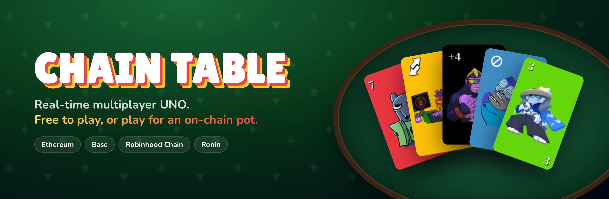

<br>

<a href="https://chain-table.alva-p.xyz"></a>

<a href="https://github.com/Chain-Table/ChainTable/actions/workflows/test.yml"></a>    

<a href="https://x.com/pimmpi_"></a> <a href="https://x.com/Miguelito_Crypt"></a>

**[English](#english)** · **[Español](#español)**

<br>

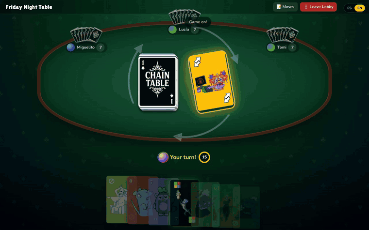

<sub>A real 4-player match, recorded from the host's seat · <i>Una partida real de 4 jugadores, vista desde el asiento del host</i></sub>

</div>

<br>

## Screenshots · Capturas

<table>
  <tr>
    <td width="50%">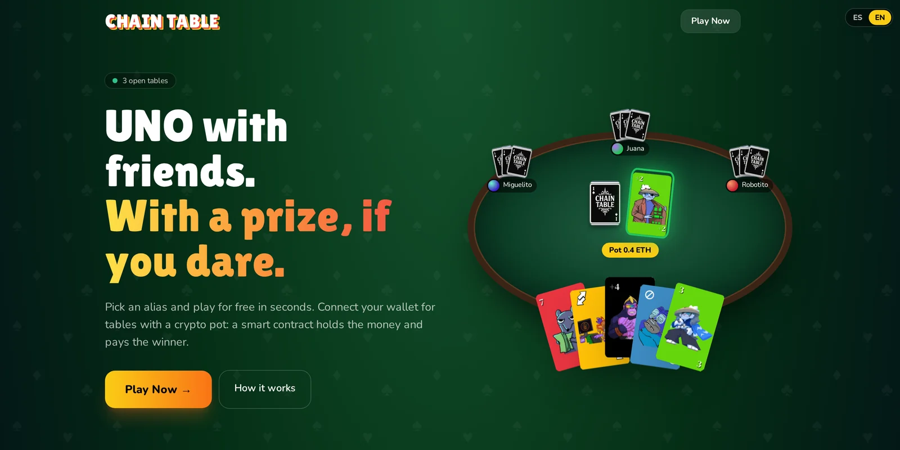</td>
    <td width="50%">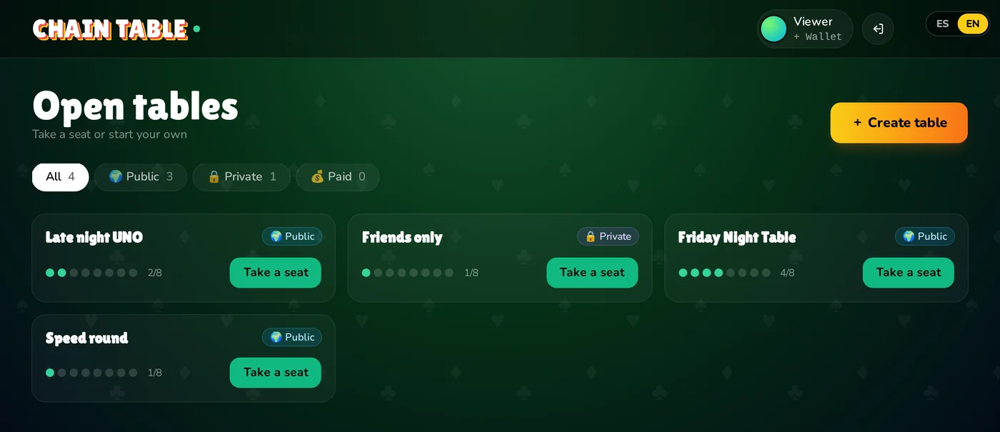</td>
  </tr>
  <tr>
    <td align="center"><b>Landing</b> · live counter of open tables</td>
    <td align="center"><b>Lobbies</b> · public, private and paid tables</td>
  </tr>
  <tr>
    <td>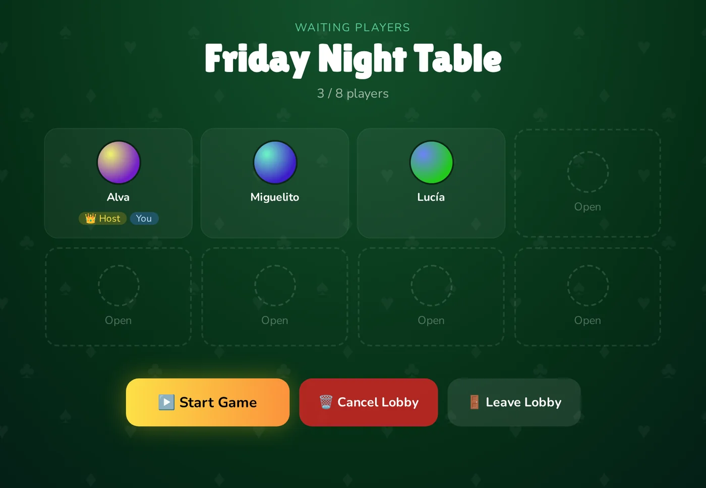</td>
    <td>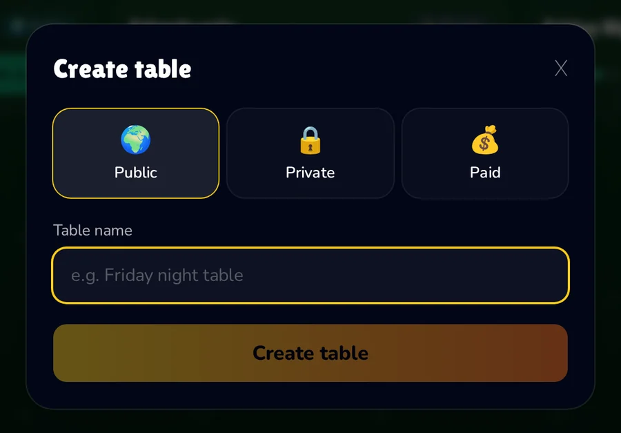</td>
  </tr>
  <tr>
    <td align="center"><b>Waiting room</b> · the host starts when ready</td>
    <td align="center"><b>Create a table</b> · in two clicks</td>
  </tr>
</table>

<table>
  <tr>
    <td width="72%">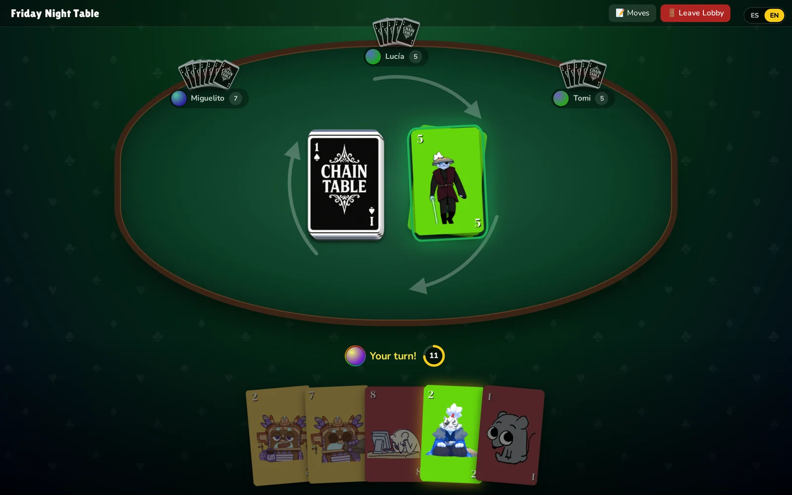</td>
    <td width="28%">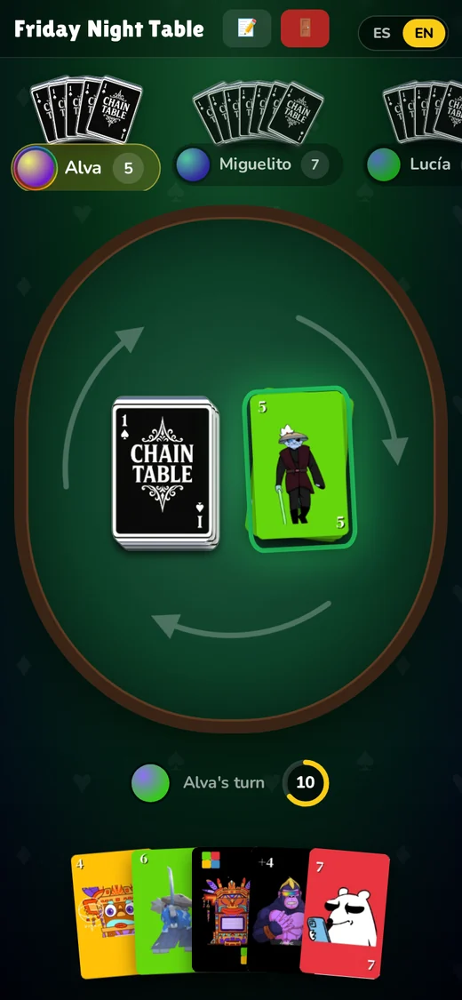</td>
  </tr>
  <tr>
    <td align="center"><b>The table</b> · turn timer, direction arrows, playable cards glow</td>
    <td align="center"><b>Mobile</b> · fully responsive</td>
  </tr>
</table>

---

<br>

# English

**ChainTable** is a real-time multiplayer card game inspired by UNO. Pick an alias and you're playing in seconds: no sign-up, no email, no wallet needed. When you want stakes, connect a wallet and sit at a **paid table**: everyone pays the same entry, the pot sits in a smart contract (not with us), and the winners are paid automatically when the game ends.

### Features

| | |
|---|---|
| **Real-time** | Every card, turn and result is synced instantly over WebSockets. |
| **Alias-first** | Play free with just a nickname. The wallet is optional until you want a prize. |
| **Three kinds of table** | Public, private (password), or paid (on-chain pot). 2 to 8 players. |
| **Turn timer** | 15 seconds per turn. If you run out of time you draw and pass; the game never plays a card for you. |
| **Stacking** | Answer a +2 with a +2, or a +4 with a +4, and pass the pile on to the next player. |
| **Full ranking** | The game goes on after the first player finishes, so 2nd and 3rd place are decided too. |
| **Trust-minimised prizes** | The contract holds the pot and can only pay the players at that table. |
| **ES / EN** | Fully translated interface, desktop and mobile. |

### How to play

1. **Pick an alias** (or connect your wallet and use it as your name).
2. **Take a seat** at an open table, or create your own.
3. When there are at least 2 players, **the host starts the game**. Everyone gets 7 cards.
4. On your turn, **play a card that matches the color or the value** of the top card.
5. **Action cards:** ⊘ Skip, ⇄ Reverse, +2 makes the next player draw two.
6. **Wild cards** change the active color; **+4** also makes the next player draw four.
7. Can't play? **Draw a card**: play it if it fits, otherwise pass.
8. **Empty your hand first** to win, and keep watching to see who takes 2nd and 3rd.

### Paid tables

<p align="center">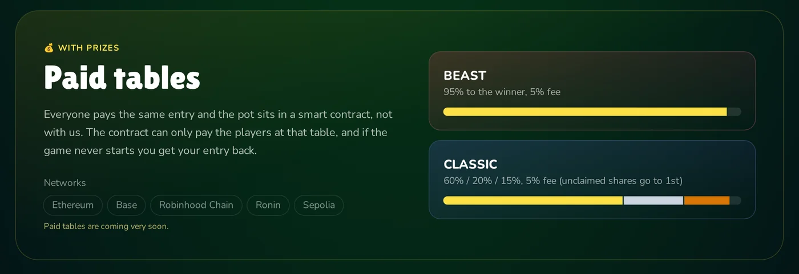</p>

Paid tables are handled by a single contract, [`contracts/ChainTable.sol`](contracts/ChainTable.sol), using the network's **native token** (no approvals, no ERC-20s).

| Mode | 1st | 2nd | 3rd | Fee |
|---|:---:|:---:|:---:|:---:|
| **BEAST** | 95% | – | – | 5% |
| **CLASSIC** | 60% | 20% | 15% | 5% |

In CLASSIC the last player is never paid, and any share that isn't awarded (for example, 3rd place in a 3-player game) goes to 1st.

<p align="center">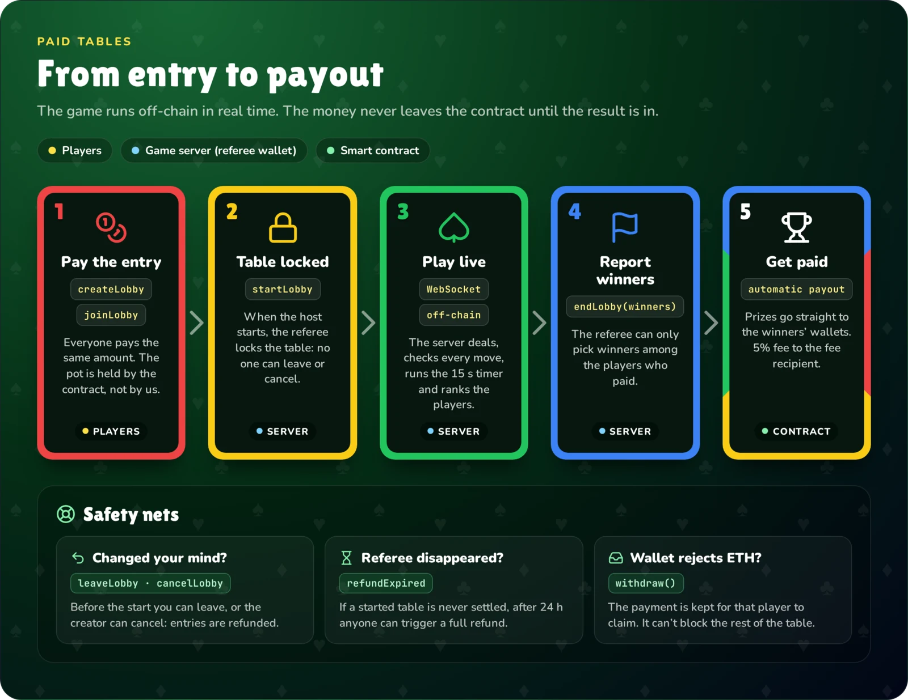</p>

**Security guarantees**

- Only the game server's **referee** wallet can start or end a table, and it can only choose winners **among the players who paid**.
- Before the game starts, a player can **leave and get their entry back**. The creator (or the referee) can cancel and refund everyone.
- If a started table is never settled, **anyone** can call `refundExpired` after **24 h** and every player gets their entry back.
- The **owner cannot move player funds**. Ownership uses `Ownable2Step`, and every payout path is `nonReentrant`.
- A recipient that rejects ETH can't block the table: that payment is kept for them to claim with `withdraw()`.

**Networks**

| Network | Token |
|---|---|
| Ethereum | ETH |
| Base | ETH |
| Robinhood Chain | ETH |
| Ronin | RON |
| Sepolia (testnet) | ETH |

A network only appears in the app once a contract address is configured for it.

### Architecture

<p align="center">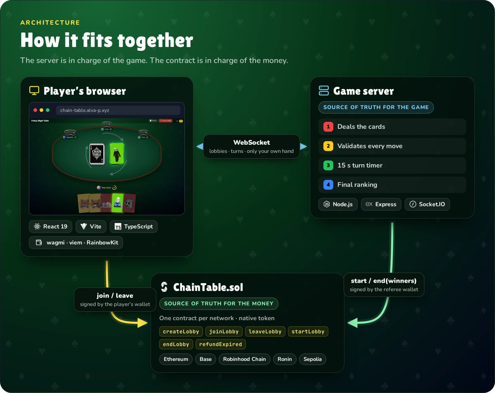</p>

- **The server is the source of truth for the game.** It deals, validates every move, runs the turn timer and decides the ranking. Each player only receives their own hand.
- **The contract is the source of truth for the money.** The server can only end the table with winners who are on-chain players.

| Layer | Stack |
|---|---|
| Frontend | React 19, TypeScript, Vite, Tailwind CSS, react-i18next |
| Web3 | wagmi, viem, RainbowKit (frontend) · ethers v6 (server) |
| Realtime | Socket.IO 4 |
| Contracts | Solidity 0.8.30, OpenZeppelin, Foundry |
| Hosting | Vercel (frontend) · Docker (backend) |

### Run it locally

**Requirements:** Node.js ≥ 22.10 and [Foundry](https://book.getfoundry.sh/) (only for the contracts).

```bash
git clone --recursive https://github.com/Chain-Table/ChainTable.git
cd ChainTable

# 1. Game server → http://localhost:3001
cd server && npm install && npm start

# 2. Frontend → http://localhost:5173 (in another terminal)
npm install && npm run dev
```

Free tables work as-is. Paid tables need the variables in [`.env.example`](.env.example).

### Tests

```bash
forge test                       # contract unit tests
cd server
npm run test:turns               # game engine and turn logic
npm run test:security            # abuse: event spam, junk payloads, sneaking into started games
npm run test:e2e                 # full paid table on a local anvil chain
```

### Deploying the contract

```bash
REFEREE_ADDRESS=0x... FEE_RECIPIENT=0x... \
  forge script script/DeployChainTable.s.sol --rpc-url base --broadcast --private-key $DEPLOYER_KEY
```

Then set `CONTRACT_<NETWORK>`, `RPC_URL_<NETWORK>` and `REFEREE_PRIVATE_KEY` on the server, and `VITE_CONTRACT_<NETWORK>` on the frontend. Use a dedicated referee wallet that only holds gas, never the owner's.

<br>

---

<br>

# Español

**ChainTable** es un juego de cartas multijugador en tiempo real inspirado en el UNO. Elegís un alias y en segundos estás jugando: sin registro, sin mail y sin wallet. Si querés jugar por algo, conectás tu wallet y te sentás en una **mesa paga**: todos pagan la misma entrada, el pozo queda en un contrato inteligente (no en nuestras manos) y a los ganadores se les paga solo cuando termina la partida.

### Características

| | |
|---|---|
| **Tiempo real** | Cada carta, turno y resultado se sincroniza al instante por WebSockets. |
| **Primero el alias** | Jugá gratis solo con un apodo. La wallet es opcional hasta que quieras premio. |
| **Tres tipos de mesa** | Pública, privada (con contraseña) o paga (pozo on-chain). De 2 a 8 jugadores. |
| **Timer por turno** | 15 segundos por turno. Si se te acaba el tiempo, robás y pasás; el juego nunca juega una carta por vos. |
| **Acumulación** | Respondé un +2 con otro +2, o un +4 con otro +4, y el castigo pasa al siguiente. |
| **Ranking completo** | La partida sigue cuando alguien termina, así también se definen el 2.º y el 3.º puesto. |
| **Premios sin confianza ciega** | El contrato guarda el pozo y solo puede pagarles a los jugadores de esa mesa. |
| **ES / EN** | Interfaz traducida, en escritorio y en el celular. |

### Cómo se juega

1. **Elegí un alias** (o conectá tu wallet y usala como nombre).
2. **Sentate** en una mesa abierta o creá la tuya.
3. Con al menos 2 jugadores, **el host arranca la partida**. Cada uno recibe 7 cartas.
4. En tu turno, **tirá una carta del mismo color o del mismo valor** que la de arriba.
5. **Cartas de acción:** ⊘ Saltar, ⇄ Reversa, +2 hace robar dos al siguiente.
6. **Los comodines** cambian el color activo; el **+4** además hace robar cuatro.
7. ¿No tenés jugada? **Robá una carta**: si sirve la tirás, si no, pasás.
8. **Quedate sin cartas primero** para ganar, y quedate mirando para ver quién sale 2.º y 3.º.

### Mesas pagas

<p align="center"></p>

Las mesas pagas las maneja un único contrato, [`contracts/ChainTable.sol`](contracts/ChainTable.sol), con el **token nativo** de cada red (sin approves ni ERC-20).

| Modo | 1.º | 2.º | 3.º | Comisión |
|---|:---:|:---:|:---:|:---:|
| **BEAST** | 95% | – | – | 5% |
| **CLASSIC** | 60% | 20% | 15% | 5% |

En CLASSIC el último nunca cobra, y la parte que no se reparte (por ejemplo, el 3.º puesto en una mesa de 3) va para el 1.º.

<p align="center">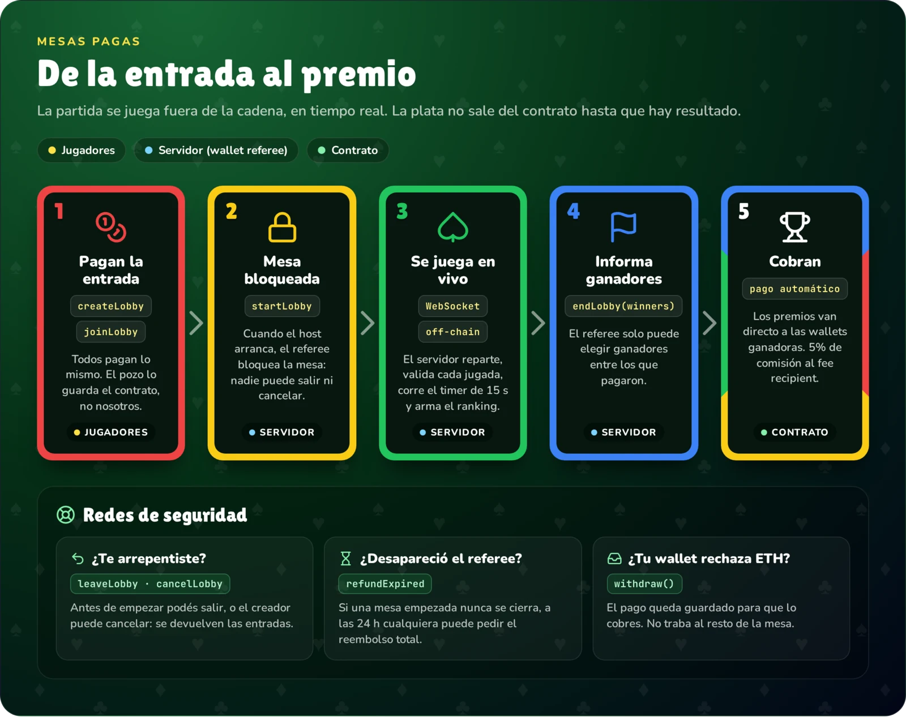</p>

**Garantías de seguridad**

- Solo la wallet **referee** del servidor puede empezar o cerrar una mesa, y solo puede elegir ganadores **entre los jugadores que pagaron**.
- Antes de que empiece, un jugador puede **salir y recuperar su entrada**. El creador (o el referee) puede cancelarla y se les devuelve a todos.
- Si una mesa empezada nunca se cierra, **cualquiera** puede llamar a `refundExpired` pasadas **24 h** y cada jugador recupera su entrada.
- El **owner no puede mover la plata de los jugadores**. El ownership usa `Ownable2Step` y todos los pagos son `nonReentrant`.
- Una dirección que rechaza ETH no puede trabar la mesa: ese pago queda guardado para que lo cobre con `withdraw()`.

**Redes**

| Red | Token |
|---|---|
| Ethereum | ETH |
| Base | ETH |
| Robinhood Chain | ETH |
| Ronin | RON |
| Sepolia (testnet) | ETH |

Una red aparece en la app recién cuando tiene una dirección de contrato configurada.

### Arquitectura

<p align="center">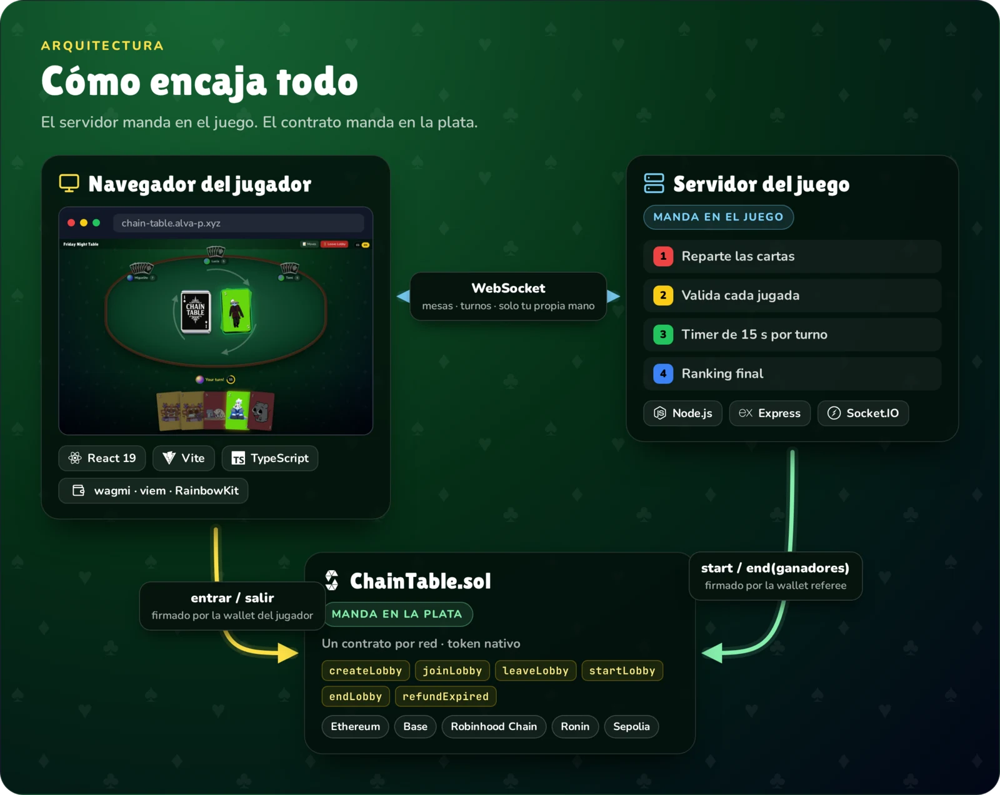</p>

- **El servidor manda en el juego.** Reparte, valida cada jugada, corre el timer y define el ranking. Cada jugador recibe solo su propia mano.
- **El contrato manda en la plata.** El servidor solo puede cerrar la mesa con ganadores que sean jugadores on-chain.

| Capa | Tecnologías |
|---|---|
| Frontend | React 19, TypeScript, Vite, Tailwind CSS, react-i18next |
| Web3 | wagmi, viem, RainbowKit (frontend) · ethers v6 (servidor) |
| Tiempo real | Socket.IO 4 |
| Contratos | Solidity 0.8.30, OpenZeppelin, Foundry |
| Hosting | Vercel (frontend) · Docker (backend) |

### Correrlo en local

**Requisitos:** Node.js ≥ 22.10 y [Foundry](https://book.getfoundry.sh/) (solo para los contratos).

```bash
git clone --recursive https://github.com/Chain-Table/ChainTable.git
cd ChainTable

# 1. Servidor del juego → http://localhost:3001
cd server && npm install && npm start

# 2. Frontend → http://localhost:5173 (en otra terminal)
npm install && npm run dev
```

Las mesas gratis funcionan así nomás. Para las pagas hacen falta las variables de [`.env.example`](.env.example).

### Tests

```bash
forge test                       # tests unitarios del contrato
cd server
npm run test:turns               # motor del juego y turnos
npm run test:security            # abusos: spam de eventos, datos basura, colarse en partidas
npm run test:e2e                 # mesa paga completa contra una red local de anvil
```

### Deploy del contrato

```bash
REFEREE_ADDRESS=0x... FEE_RECIPIENT=0x... \
  forge script script/DeployChainTable.s.sol --rpc-url base --broadcast --private-key $DEPLOYER_KEY
```

Después configurá `CONTRACT_<RED>`, `RPC_URL_<RED>` y `REFEREE_PRIVATE_KEY` en el servidor, y `VITE_CONTRACT_<RED>` en el frontend. Usá una wallet referee dedicada que solo tenga gas, nunca la del owner.

<br>

---

<div align="center">

## Made by · Hecho por

<table>
  <tr>
    <td align="center" width="220">
      <a href="https://github.com/alva-p"><br><b>Alva</b></a><br>
      <a href="https://x.com/pimmpi_">@pimmpi_</a><br>
      <a href="https://github.com/alva-p">GitHub</a>
    </td>
    <td align="center" width="220">
      <a href="https://github.com/MiguelSc66"><br><b>Miguel</b></a><br>
      <a href="https://x.com/Miguelito_Crypt">@Miguelito_Crypt</a><br>
      <a href="https://github.com/MiguelSc66">GitHub</a>
    </td>
  </tr>
</table>

If you liked it, follow us on X and leave a star · Si te gustó, seguinos en X y dejá una estrella

<sub>ChainTable is an independent fan project and is not affiliated with Mattel or UNO®. · ChainTable es un proyecto independiente, sin relación con Mattel ni UNO®.</sub>

</div>
